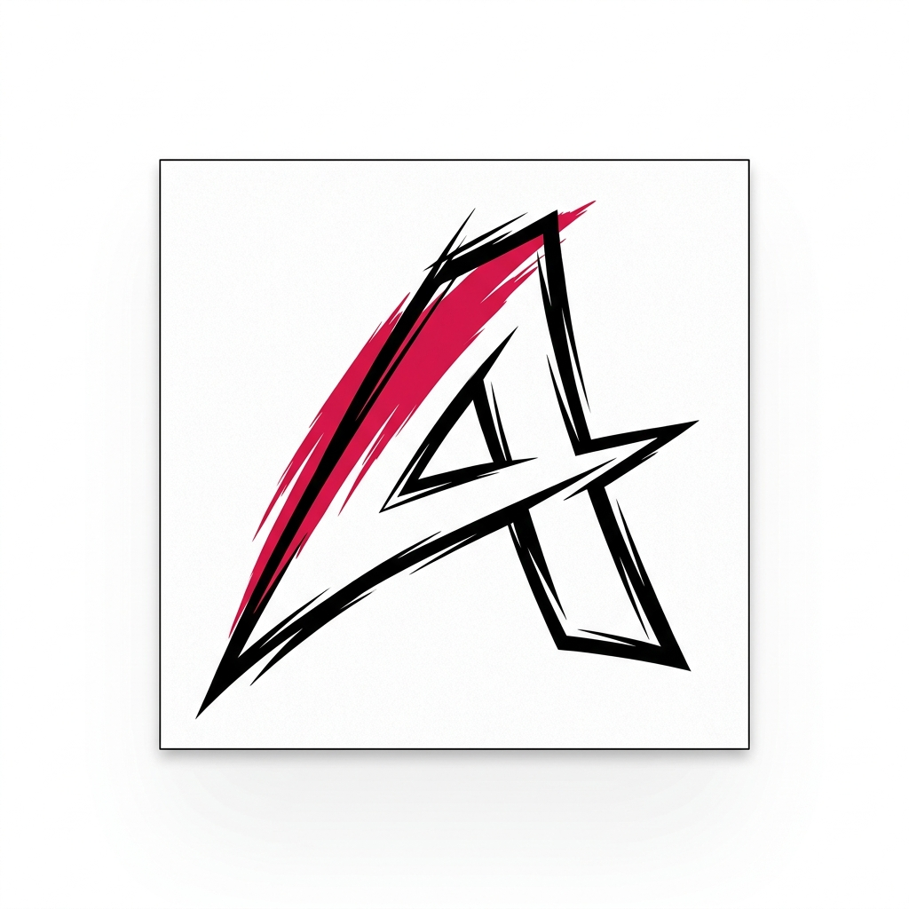
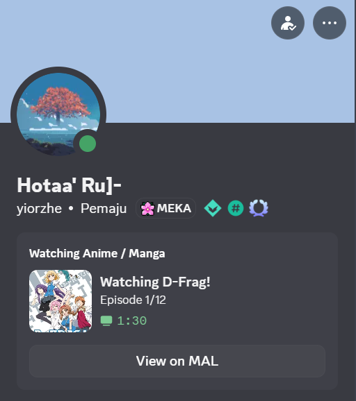
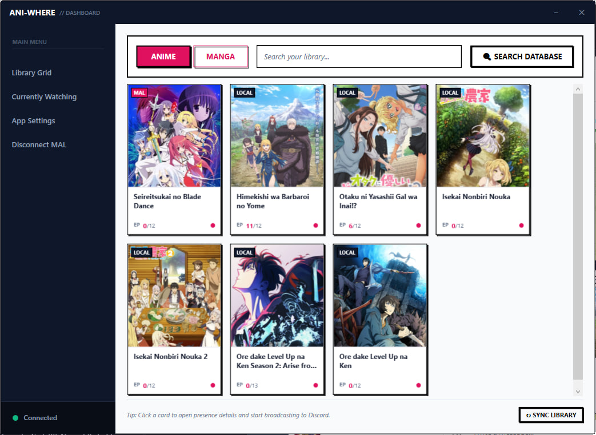
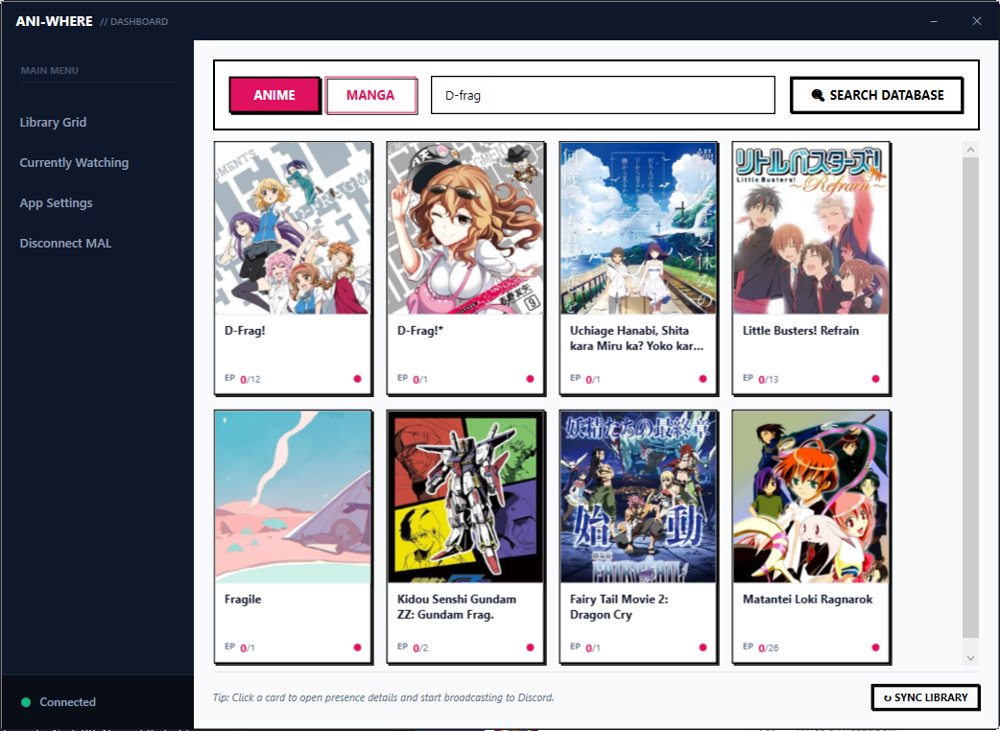
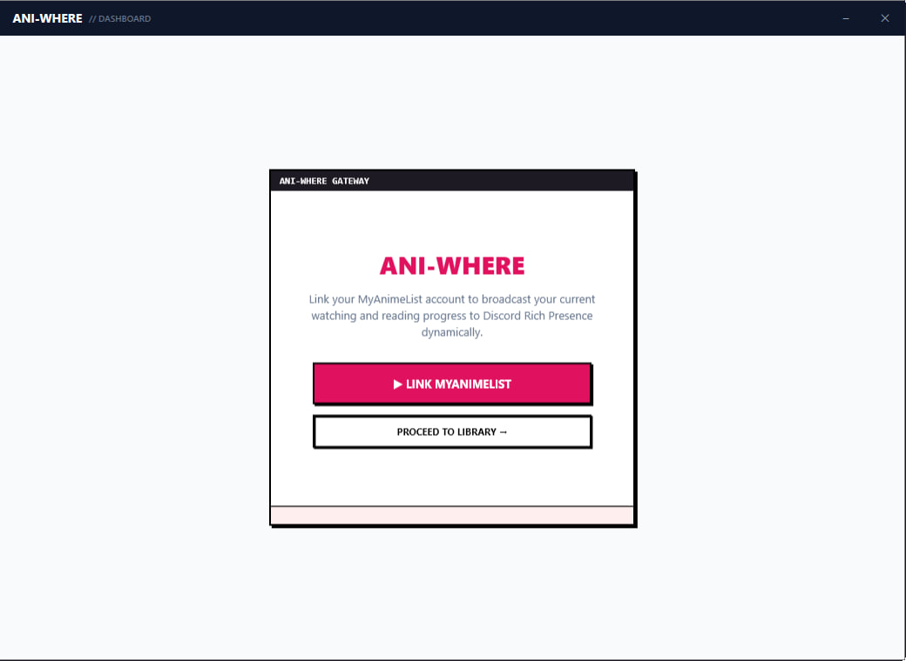
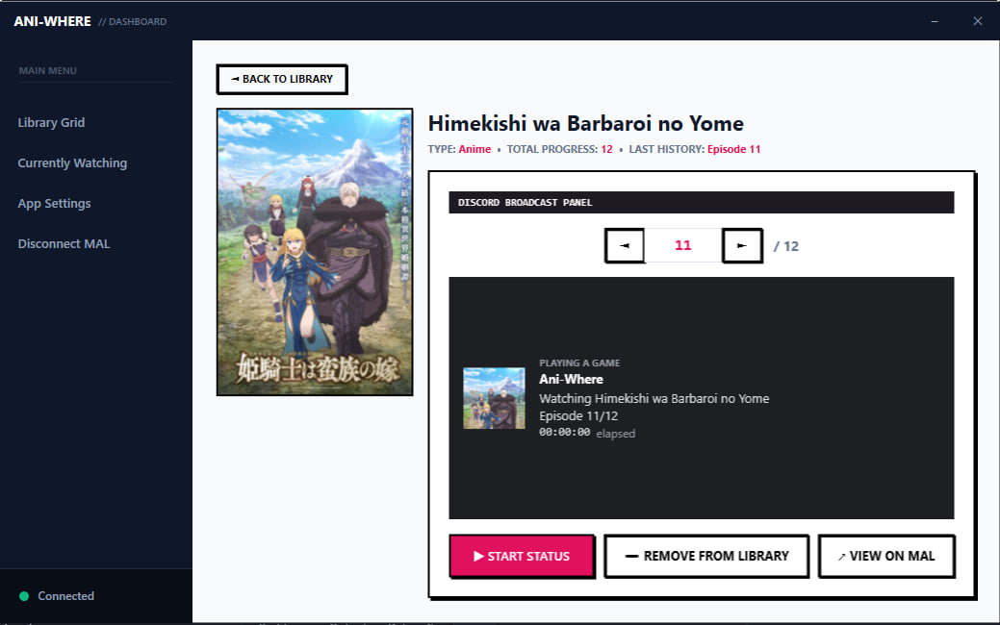
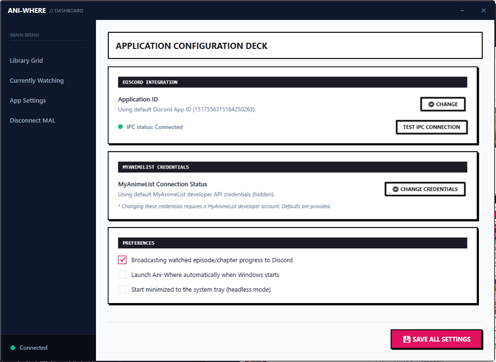

<p align="center">
  
</p>

<h1 align="center">Ani-Where</h1>

<p align="center">
  <strong>A high-contrast, premium WPF companion for MyAnimeList and Discord Rich Presence</strong>
</p>

<p align="center">
  <a href="#-features">Features</a> •
  <a href="#-design-language">Design Language</a> •
  <a href="#-getting-started">Getting Started</a> •
  <a href="#-installer-compilation">Installer Compilation</a>
</p>

---

## 📖 Overview

**Ani-Where** is a lightweight, premium WPF desktop application that automatically broadcasts your active MyAnimeList (MAL) anime watching and manga reading progress directly to your Discord Rich Presence status. 

Designed with a high-contrast **retro Manga aesthetic**, it combines a beautiful, responsive user interface with robust offline safety fallbacks, secure credential storage, and local progress history tracking.

---

## 📷 Screenshots

### 💬 Discord Profile Status Display
<p align="center">
  
</p>

### 🗃️ Active Library Grid
<p align="center">
  
</p>

### 🔍 Search & Discovery
<p align="center">
  
</p>

### 🎮 Connection, Controls & Settings Panels
<p align="center">
  
  &nbsp;&nbsp;&nbsp;&nbsp;
  
  &nbsp;&nbsp;&nbsp;&nbsp;
  
</p>

---

## ✨ Features

- **⚡ Live Discord Rich Presence:**
  - Auto-detects media types: broadcasts "Watching {Title}" with a matching television screen icon, or "Reading {Title}" with a matching book icon.
  - Dynamically displays progress details (e.g. `Episode 3/12` or `Chapter 14/95`) alongside the active elapsed time and a clickable **"View on MAL"** status button.

- **💾 Local Library Manager:**
  - Save your favorite anime and manga directly to your local library.
  - Features high-contrast origin badges (`MAL` / `LOCAL`) overlays to visually identify where each entry came from.

- **📜 Local Progress History:**
  - Keeps track of where you left off by storing your watch and read history in a local cache.
  - Integrates with MAL on launch, automatically resolving conflicts by taking the latest/highest progress value.
  - Shows your last history progress directly on the details page (e.g., `• LAST HISTORY: Episode 3`).

- **🔒 Secure Local Encryption:**
  - Stores all MyAnimeList client secrets and user access tokens securely using the **Windows Data Protection API (DPAPI)** to prevent credentials exposure.

- **🌐 Offline Bypass Flow:**
  - Easily run the app in offline/bypass mode if the network or MAL is down. The app displays an intuitive status message and falls back to loading your local library.

- **⏳ Independent Session Control:**
  - Manage and track active Discord broadcasts. Navigation between panels (Search, Settings, Library) will never interrupt your active broadcast session or reset the status timer.

---

## 🎨 Design Language (Manga Style)

Ani-Where is designed with a unique visual styling modeled after hand-drawn manga ink frames:
* **Hard Outlines & Sharp Edges:** Zero corner rounding on panels, buttons, inputs, and image borders (`CornerRadius="0"`) for a crisp, structured frame.
* **Flat Offset Shadows:** Solid black block shadows with zero blur (`BlurRadius="0"`, `ShadowDepth="4"`, `Opacity="1.0"`) to replicate manga ink depth.
* **Curated Color Palette:** High-contrast solid slate backgrounds, clean white content panels, and a primary `#E0115F` ruby red accent.

---

## 🛠️ Tech Stack & Architecture

* **Framework:** .NET 8.0 & WPF (Windows Presentation Foundation)
* **Architecture Pattern:** MVVM (Model-View-ViewModel) powered by the `CommunityToolkit.Mvvm` SDK
* **Discord Integration:** `DiscordRichPresence` (C# Wrapper for Discord RPC)
* **Storage:** Windows DPAPI & `System.Text.Json` local databases

---

## 🚀 Getting Started

### Prerequisites
* **.NET 8.0 SDK** or newer
* **Discord Desktop Client** (running in the background)

### 1. Build and Run (Local Dev)
Clone the repository and compile the application using the dotnet CLI:
```bash
# Restore dependencies
dotnet restore

# Run application in debug mode
dotnet run --project MALDiscordPresence
```

### 2. Compile Release Binary
To compile a single-folder self-contained win-x64 release bundle:
```bash
# Clean previous build caches
Remove-Item -Path "MALDiscordPresence/obj", "MALDiscordPresence/bin" -Recurse -Force -ErrorAction SilentlyContinue

# Publish release
dotnet publish MALDiscordPresence -c Release -r win-x64 --self-contained true -o ./publish
```

---

## 📦 Installer Compilation

The project contains an Inno Setup script (`setup.iss`) to package the published binaries into a native installer `AniWhereSetup.exe`.

1. Install **Inno Setup 6** (via winget):
   ```bash
   winget install --id JRSoftware.InnoSetup -e --silent
   ```
2. Compile the installer script:
   ```bash
   & "$env:LocalAppData\Programs\Inno Setup 6\ISCC.exe" setup.iss
   ```
3. Locate the compiled setup package in the `Output` directory:
   * `Output/AniWhereSetup.exe`
